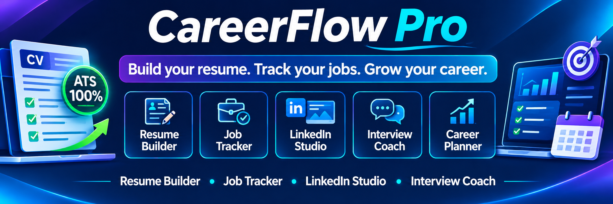

# CareerFlow Pro — Free Career Toolkit



**Build your resume. Track your jobs. Grow your career.**

> **Important:** The app's evidence-backed requirement coverage and resume keyword coverage are transparent estimates, **not official ATS scores**. No third-party application can guarantee 90% or 100% on an employer’s ATS or guarantee interviews. Only confirm demonstrable skills and achievements.

## Latest release — Enhanced resume matching and LinkedIn studio

- **Job requirement analysis:** filters out job-board clutter and extracts role-relevant requirements with priorities.
- **Editable proof editor:** each matched/missing requirement has a confirmation checkbox and editable evidence field; add requirements manually, correct facts, and rerun.
- **Live recalculation:** separate evidence-backed requirement coverage and keyword coverage of the editable resume.
- **Evidence-led rewrite:** reorders existing experience, adds confirmed evidence and preserves existing role history; never fabricates qualifications to increase a number.
- **Editable resume:** easy line editor and full text editor, plus existing Word/PDF/text downloads and styling.
- **LinkedIn content studio:** 3 editable posts without an API key, optional Gemini writing, post-to-image workflow and downloadable image/banner. Actual LinkedIn posting requires manual confirmation on LinkedIn.
- **Website banner:** `careerflow-banner.png` included for README and landing page. The banner’s 100% ATS motif is an aspirational visual, not a validation claim.

### How to update your GitHub Pages website

Upload **all files** in this folder to the repository root. Keep `.js`, `.css`, `.html` and `careerflow-banner.png` together. GitHub Settings → Pages → Deploy from branch → `main` → `/ (root)`. No build or install needed.

### Security and data

The local tools store supported information in the browser. If you use Gemini, your input is sent to the Gemini API with your supplied key; avoid confidential data. A browser-exposed API key is not appropriate for a production multi-user service: use a secure backend for public commercial deployment.

---

<div align="center">

# CareerFlow Pro

### Build Your Resume. Track Your Jobs. Grow Your Career.

**Free career toolkit | Privacy-focused | No sign-up required**

[Try the live app](https://venkatbanday.github.io/Automated-job-application-and-LinkedIn-posting-app/) · [Report an issue](https://github.com/venkatbanday/Automated-job-application-and-LinkedIn-posting-app/issues)

</div>

> **Note:** The links above point to the original repository and website provided with this project. If you create a new repository called `careerflow-pro`, change these URLs after publishing.

## About

CareerFlow Pro is a browser-based toolkit for job seekers. Tailor a resume to a job description, organise applications and recruiter contacts, prepare for interviews, create LinkedIn content, compare job offers and plan weekly career activities. Core tools work locally without creating an account.

## Features

| Tool | What it does |
| --- | --- |
| **CV Match** (`index.html`) | Compare CV text against a job description; see keyword coverage and CV checks. This is **not** a real applicant tracking system score. |
| **Resume Builder** (`resume-builder.html`) | Upload/paste a CV, review genuine skills, create tailored resumes and cover letters, edit templates, and export Word, print-to-PDF or text. |
| **Career Hub** (`career-hub.html`) | Track applications, recruiters, interview dates, follow-ups, outreach messages and LinkedIn profile ideas. |
| **LinkedIn Post Maker** (`linkedin-post.html`) | Draft posts with optional Gemini AI, design image cards and banners, and prepare a seven-day content plan. Posting itself is manual. |
| **Career Studio** (`career-studio.html`) | Practise STAR interview answers, compare offers, manage a weekly activity plan and generate a professional pitch. |

## Getting started

1. Download or clone the repository.
2. Open `index.html` in a modern browser, or publish the files using GitHub Pages.
3. Open the tools from the homepage. Keep all HTML, CSS and JavaScript files together in the same directory.

No build system or backend server is required. An internet connection is needed for optional external libraries and AI features.

## Project files

```text
index.html
resume-builder.html
career-hub.html
linkedin-post.html
career-studio.html
career-studio.js
studio.css
studio-nav.js
README.md
```

## GitHub Pages deployment

1. Upload the files listed above to the **root** of your repository (not inside a nested ZIP folder).
2. Go to **Settings → Pages → Build and deployment**.
3. Select **Deploy from a branch**, branch **main**, folder **/(root)**, then **Save**.
4. Open `https://YOUR-USERNAME.github.io/YOUR-REPOSITORY/` once publishing finishes.

If you use a new repository named `careerflow-pro`, your website address will be `https://YOUR-USERNAME.github.io/careerflow-pro/`.

## Privacy and AI

Most data is stored in your browser using localStorage, not a cloud account. Back up important data using the available export controls. Clearing browser data or changing devices can lose local data.

Optional Gemini features send the text you submit to Google's API using a key you provide. Review the provider's privacy and usage terms before sharing sensitive information. Do not commit API keys or personal resumes to a public GitHub repository.

## Accuracy and limitations

- Keyword coverage is an informational guide, not a verified ATS score or job-placement guarantee.
- Do not add experience, skills, qualifications, figures or achievements you cannot substantiate.
- The app does **not** automatically apply for jobs, scrape LinkedIn or auto-publish posts.
- The offer comparison is illustrative; it is not financial or tax advice.
- Interview questions are practice prompts, not predictions of a particular employer's questions.
- Scanned PDFs and legacy `.doc` files may require manual text extraction; check uploaded text before exporting.
- Browser and accessibility testing across devices is still recommended before broader release.

## Technology

HTML5 · CSS3 · Vanilla JavaScript · Browser localStorage · Optional Gemini API · Optional document-processing libraries via CDN.

## About the creator

Created by **Venkateswararao Banday**, a programme and operations professional sharing free tools with fellow job seekers.

[LinkedIn](https://www.linkedin.com/in/venkateswararao-banday)

## Licence

No licence file is included. Add a licence (for example MIT) if you want to give others explicit permission to reuse and modify the source code.
